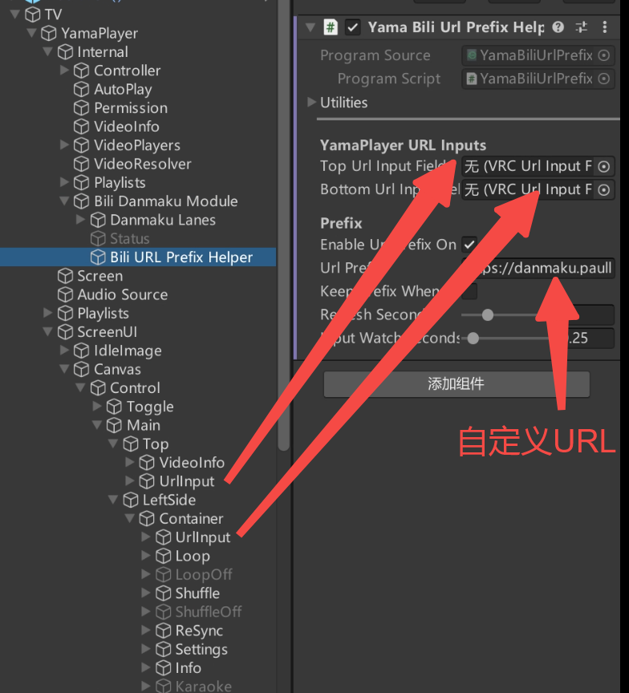
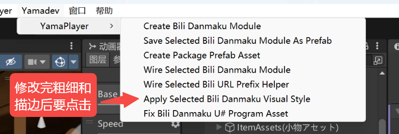

# PaulKoiPlayer

<p align="center">
  
</p>

[简体中文](README.md) | [English](README_EN.md)

PaulKoiPlayer 为 VRChat 世界内的 YamaPlayer、iwaSync3 和 VizVid 提供哔哩哔哩弹幕。

## Unity 安装

1. 打开装有 [VRChat Worlds SDK](https://creators.vrchat.com/sdk/) 和 [YamaPlayer 1.5.18](https://github.com/koorimizuw/YamaPlayer/releases/tag/1.5.18) 的 VCC 世界工程。
2. 下载并解压到 Unity 工程根目录，让包内的 `Assets/` 合并进去。[PaulKoiPlayer-YamaPlayer.zip](https://github.com/sodakitten/PaulKoiPlayer-vrc-bilibili-danmaku/releases/download/v1.3/PaulKoiPlayer-YamaPlayer.zip)
3. 在场景中选中播放器，点击 `Tools > PaulKoiPlayer > Install Danmaku > YamaPlayer`。

安装菜单会准备 TMP Essentials、生成并编译 UdonSharp 程序、绑定标准播放器引用。重复执行会选中现有模块。已有 V3 场景可以在原路径覆盖源码，保留项目内的 `.meta` 文件。接线修复和视觉调整在 `Tools > PaulKoiPlayer > Advanced` 中。

从源码打包可执行 `python tools/package-unity.py <输出目录>`。其他播放器、Quest 适配和历史版本见 [GitHub Releases](https://github.com/sodakitten/PaulKoiPlayer-vrc-bilibili-danmaku/releases)。

## 解析服务与世界 ID

默认使用 [PaulKoiPlayer 公共服务](https://danmaku.paulkoishi.com/)，自托管参见 [Docker 部署说明](server/README.Docker.md)。构建世界时，插件读取场景的 VRChat Blueprint ID，写入播放器 URL 前缀及 YamaPlayer 桌面端的 VCRID 地址。没有世界 ID 的请求照常播放。玩家手动粘贴的完整播放地址保留原参数。

公网首页展示累计返回弹幕数、播放跳转次数等汇总值。配置 `ADMIN_TOKEN` 后，可在 `/admin` 切换「服务数据」和「自定义视频弹幕」，查询播放与解析记录以及使用服务器的世界 ID。

## URL 输入框绑定

桌面适配器会针对 YamaPlayer 1.5.18，从 `UIController` 权威引用或下表精确路径自动补齐预输入前缀组件中为空的两个 URL 输入框；已有手动引用不会被覆盖。自定义或改名预制体无法精确匹配时仍应手动拖入，任何版本都不要依赖组件顺序或宽泛名称猜测。

| Inspector 字段 | YamaPlayer 默认对象路径 |
| --- | --- |
| `Top Url Input Field` | `ScreenUI/Canvas/Control/Main/Top/UrlInput` |
| `Bottom Url Input Field` | `ScreenUI/Canvas/Control/Main/LeftSide/Container/UrlInput` |

需要手动回退时，两个对象都应拖入其自身的 `VRC URL Input Field` 组件。



前缀设置：

- `Enable Url Prefix On Input`：控制预输入功能，默认开启。
- `Url Prefix`：自定义解析服务地址；不自托管时可填写 `https://danmaku.paulkoishi.com/player/?url=`。
- `Keep Prefix When Empty`：持续补回空输入框；若希望玩家可以手动删除前缀，请保持关闭。

## 播放视频

开启链接填充后，在输入框预填的服务前缀后粘贴 B 站或网易云链接。有 Blueprint ID 的世界会用这个前缀上报世界 ID。网易云歌单可加 `&p=2` 选择第二首。

## 常用设置

> **这些设置只能在 Unity 编辑器中调整。** YamaPlayer 1.11 生成轻量的玩家控制与播放列表界面。字体大小、透明度、粗细、描边、轨道数、滚动速度和时间偏移仍需要由世界作者在 Unity Inspector 中配置，并在上传世界前保存。

| 设置 | 默认值 | 说明 |
| --- | ---: | --- |
| `Lane Count` | 12 | 弹幕轨道数量 |
| `Scroll Duration` | 8 | 滚动弹幕通过画面的秒数 |
| `Static Duration` | 4 | 顶部/底部弹幕停留秒数 |
| `Time Offset Ms` | 0 | 弹幕时间校正 |
| `Max Danmaku Lines` | 4096 | 单次加载的最大弹幕条数 |
| `Font Scale` | 1.1 | 字体显示缩放 |
| `Text Alpha` | 0.72 | 字体透明度 |
| `Outline Width` | 0.11 | TMP 黑色描边宽度 |
| `Outline Alpha` | 0.7 | 描边透明度 |

### 让描边和粗体修改真正生效

`Editor Visual Style` 下的粗体、描边宽度和描边透明度不是运行时实时修改项。调整现有模块后，必须重新把设置应用到 TextMeshPro 材质：

1. 在 Hierarchy 中选中已经生成的 `Bili Danmaku Module` 对象。
2. 在 `Yama Bili Danmaku Module 3` 组件的 `Editor Visual Style` 中修改：
   - `Editor Bold Text`
   - `Editor Heavy Outline Enabled`
   - `Editor Outline Width`
   - `Editor Outline Alpha`
3. 保持该对象处于选中状态，执行：

```text
Tools > PaulKoiPlayer > Advanced > YamaPlayer > Apply Selected Bili Danmaku Visual Style
```



4. 检查 Console 出现应用成功提示，再进入 Play Mode 或重新上传世界。

只修改 Inspector 数值但不执行上述 Apply 菜单，已有弹幕文字的材质不会更新，看起来就会像描边或粗细没有变化。新生成的模块会在创建时自动应用当前默认样式。

## 世界内弹幕控制

YamaPlayer 1.11 会在 `Bili Danmaku Module` 下生成中文的轻量控制界面：

- `弹幕范围：全屏 / 半屏 / 1/4屏`：循环切换显示区域。
- `弹幕：开启 / 关闭`：切换弹幕显示与隐藏。
- `输入链接`：打开组件自己的队列输入框，使用预置解析前缀把新链接加入播放队列；正式 1.11 与 beta14.02 会为原样 YamaPlayer 1.5.18 精确补齐 Top/Bottom URL Input 空引用，并保留自定义布局的手动绑定回退。
- `播放列表`：显示 B 站分 P/合集/list 或网易云音乐歌单；可切换顺序播放和单项循环。

切换显示区域时，已经发射出来的弹幕不会被清空；后续新弹幕会按新的区域输出。

这些 Udon 公开事件仍可供世界作者自定义 UI 或脚本调用：

```text
ToggleDanmaku
EnableDanmaku
DisableDanmaku
SetFullScreenDanmaku
SetHalfScreenDanmaku
SetQuarterScreenDanmaku
CycleDisplayAreaMode
```

## 常见问题

### 安装时 UdonSharp 编译失败

查看 Unity Console 的第一条错误。确认播放器版本和依赖后，重新运行安装菜单。

### 显示 Loaded 但没有弹幕

- 确认播放器当前 URL 使用支持弹幕响应的解析服务。
- 确认 `Controller`、`Lane Root` 和 `Text Pool` 已正确绑定。
- 确认 `Danmaku Enabled` 已开启。
- 不要混用旧版组件和旧版 U# Program Asset。

## 功能

- 根据播放器当前 URL 自动请求对应弹幕
- 支持滚动、顶部和底部弹幕
- 跟随视频播放进度同步，正确处理暂停和继续播放
- 使用 `RectMask2D` 在播放器画面边缘裁切弹幕
- 支持彩色弹幕、黑色描边和轻微加粗
- 可调整字体缩放、透明度、轨道数、速度和时间偏移
- 仅更新正在显示的弹幕，降低每帧遍历开销
- URL 输入框可预填自定义解析服务前缀
- 提供弹幕开启、关闭和切换事件，方便连接世界内自定义 UI
- YamaPlayer 1.11 支持 B 站多 P/合集/list 与网易云音乐歌单，列表每页最多显示 6 项
- 支持顺序播放与单项循环，并提供首页、上一页和下一页操作；网易云歌单顺序播放时整表循环，B 站多 P 到末项后继续后续队列或停止
- Pages 状态使用轻量 Udon 手动同步，支持多人当前项目提示和后来加入玩家恢复列表

## 项目结构

- `Runtime/`、`Editor/`：YamaPlayer PC / 桌面端 Unity / UdonSharp 弹幕组件。
- `IwaBiliDanmakuV3/`：iwaSync3 专用适配线。
- `VizVidBiliDanmakuV3/`：VizVid 专用适配线。
- `YamaBiliDanmakuTabletV3/`：YamaPlayer Android / Quest 可拾取平板专用适配线。
- [`server/`](server/README.md)：视频解析与弹幕代理服务，提供 Docker 部署。
- [`docs/DEVELOPMENT_NOTES.md`](docs/DEVELOPMENT_NOTES.md)：组件试错、错误修复与演进记录。

## 历史版本说明

YamaPlayer 1.11 由 `alpha1.1` 原样晋升，在 1.10 播放逻辑基础上增加：

- 正式 UI 改为纯黑、透明黑、白色描边和纯白字体。
- 顶部三个控件共用一整条淡黑圆角背景，第三格改为“输入链接”，并与前两个控件共用 TMP 字体、图标和布局样式。
- 播放列表文字统一为纯白；当前项继续显示 `> `，并以 `0.14` 对 `0.07` 的行背景明暗区分当前项与普通项。
- 针对原样 YamaPlayer 1.5.18，从 `UIController` 权威序列化字段或两条已验证精确路径自动补齐为空的 Top/Bottom URL Input；已有手动绑定优先，自定义布局继续手动回退。
- 弹幕与网易云歌词根 Canvas 的 `sortingOrder` 从 1.10 的 `20` 调整为 `-1`，让 YamaPlayer 点击后出现的 Order `0` 灰色交互 UI 稳定覆盖弹幕；弹幕 TMP Shader 未改变。

YamaPlayer 1.10 相比 1.04beta 主要增加：

- 新增通用 `播放列表` 面板，不再只叫 `Bili Pages`；支持 B 站多 P、合集/list 和网易云音乐歌单。
- 每页最多显示 6 项，提供首页、上一页、下一页、顺序播放和单项循环按钮。
- 通过后端预生成的 `vcrid` 播放条目，避免在 Udon 运行时动态构造 `VRCUrl`。
- 网易云歌单在顺序模式下整表循环；B 站多 P 播放至末项后继续 YamaPlayer 后续队列，没有后续项目时停止。单项循环复用 YamaPlayer 自身循环状态。
- 修复首次解析、切歌和停止事件可能把完整歌单误缩成单项的问题。
- 新增轻量多人同步：同步清单来源、当前项目、循环模式和修订号；后来加入的玩家可重新下载完整列表。
- 非所有者的停止事件不会清空公共列表，列表中当前项目以播放器实际播放的 `vcrid` 为准。
- 修复多位 `vcrid` 被截断的问题，P52、P150 等较大分 P 编号能够正确匹配播放项目。
- 用户主动翻页后，首次列表加载完成或队列标题回填不会再把面板强制跳回首页。
- 世界内控制文字改为中文；保留原有弹幕下载、解析、时间同步、描边、镜子可读和显示区域行为。

1.10 只发布 YamaPlayer PC / 桌面端适配线。iwaSync3、VizVid 与 Android / Quest 平板专用线没有同步这批播放列表功能，也不包含在本次 Release 中。

1.04beta 相比 1.03 主要更新 Unity 组件端：

- PC / 桌面端重新采用已验证的外部显示面挂载逻辑：选中播放器内部对象时仍挂播放器根节点；选中外部平板或显示面时挂到当前选中的显示面 Transform。
- YamaPlayer、iwaSync3、VizVid 三条 PC 适配线保持同一挂载规则。
- Android / Quest 可拾取平板不再塞进普通 YamaPlayer 包硬修，改为独立 `YamaBiliDanmakuTabletV3` 包。

1.02 相比 1.01 主要更新 Unity 组件端：

- 将 `Max Danmaku Lines` 默认值从 1600 提高到 4096，修复高密度弹幕视频只显示开头一小段的问题。
- 弹幕关闭后不再每帧重复隐藏全部文本。
- `HideAllTexts()` 只处理当前 active 弹幕，不再遍历完整对象池。
- 新弹幕发射前只在对象仍 active 时才重置 active 状态，减少无意义 UI 状态变化。
- 新建模块不再给主弹幕 Canvas 添加多余的 `GraphicRaycaster`；重新执行 `Wire Selected Bili Danmaku Module` 会移除旧模块上的多余主 Canvas raycaster。

1.01 相比 v1.0.0 主要更新 Unity 组件端：

- 增加镜子可读的 TextMeshPro 弹幕 shader，参考 YamaPlayer 的 `_MirrorFlip` + `_VRChatMirrorMode` 镜子反转模式，在 VRChat 镜子渲染时预翻转弹幕文字，并保留现有 TMP 描边、Underlay 与轻微加粗。
- 新增 `Danmaku Controls Canvas`，提供世界内玩家可点击的弹幕开关和全屏/半屏/四分之一屏显示区域切换。
- 显示区域切换只影响后续新弹幕，已经在屏幕上的弹幕不会被清空。
- UI 事件绑定改为 backing `UdonBehaviour.SendCustomEvent`，与 YamaPlayer 的事件绑定方式一致。
- 修正长弹幕刚发射时可能在屏幕边缘闪一下的问题。

1.04beta 没有修改 `server/`，服务端继续使用 v1.0.3 对应版本。

v1.0.0 是首个统一发布版本，同时提供 Unity 组件与对应的 Docker 服务端。组件包含彩色弹幕 TMP 描边、轻微加粗、URL 前缀辅助、活动弹幕索引优化，以及暂停后继续播放时的计时补偿。

## 鸣谢与相关链接

- [danmaku.paulkoishi.com](https://danmaku.paulkoishi.com/)：当前公共解析服务状态页；如果无法访问，说明当前公共服务不可用。
- [koorimizuw/YamaPlayer](https://github.com/koorimizuw/YamaPlayer)：本项目 PC 适配固定参考上游 YamaPlayer 1.5.18；当前组件正式版本为 1.11。
- [music.znnu.com](https://music.znnu.com/)：服务端网易云音乐解析所使用的第三方服务。
- [yionchi](https://github.com/yionchi)：`music.znnu.com` 相关服务作者。

## 后续计划

后续版本会继续补充弹幕密度/数量控制、更多显示区域选项，以及适合 VRChat 的简洁设置界面。实现时会优先保护当前稳定的加载、同步和渲染路径。
