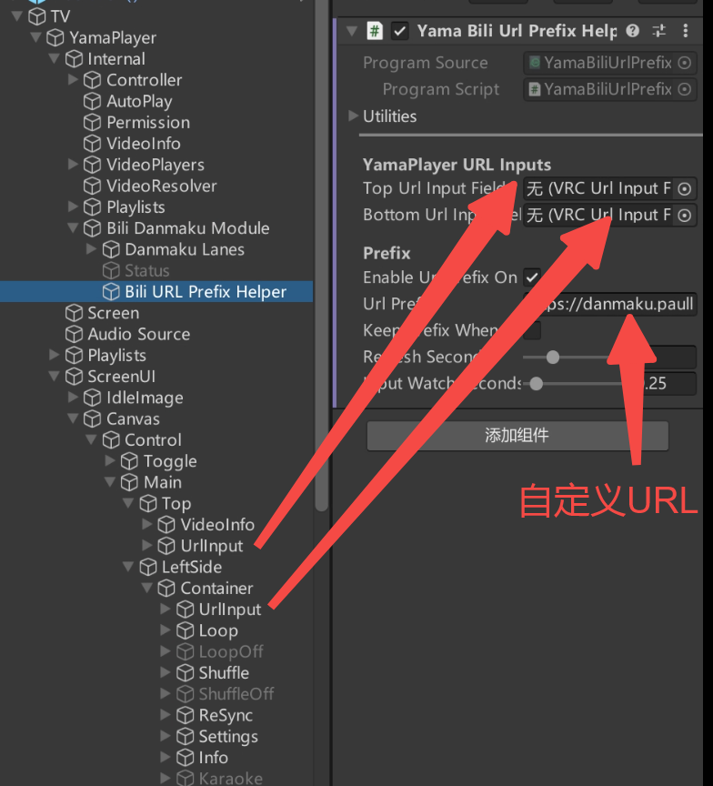
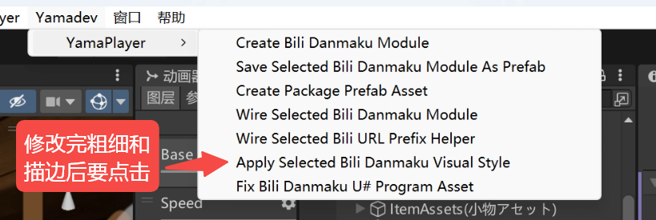

# PaulKoiPlayer

<p align="center">
  
</p>

[简体中文](README.md) | [English](README_EN.md)

PaulKoiPlayer loads and displays Bilibili danmaku in VRChat worlds using YamaPlayer, iwaSync3, or VizVid.

## Install in Unity

1. Open a VCC Worlds project with the [VRChat Worlds SDK](https://creators.vrchat.com/sdk/) and [YamaPlayer 1.5.18](https://github.com/koorimizuw/YamaPlayer/releases/tag/1.5.18).
2. Download and extract the ZIP into the Unity project root so its contents merge into `Assets/`. [PaulKoiPlayer-YamaPlayer.zip](https://github.com/sodakitten/PaulKoiPlayer-vrc-bilibili-danmaku/releases/download/v1.3/PaulKoiPlayer-YamaPlayer.zip)
3. Select the player in the scene and click `Tools > PaulKoiPlayer > Install Danmaku > YamaPlayer`.

The menu prepares TMP Essentials and UdonSharp program assets and wires supported player inputs. Running it again on the same player selects the installed module. For an existing V3 scene, overwrite the source at its original paths while retaining the project's `.meta` files. Use `Tools > PaulKoiPlayer > Advanced` for reference repair or visual changes.

Build the ZIP from this checkout with `python tools/package-unity.py <output-directory>`. Other adapters, Quest builds and earlier versions are available in [GitHub Releases](https://github.com/sodakitten/PaulKoiPlayer-vrc-bilibili-danmaku/releases).

## Service and world ID

The default service is [danmaku.paulkoishi.com](https://danmaku.paulkoishi.com/). To self-host, see [Docker setup](server/README.Docker.md). During a world build, the plugin reads the scene's VRChat Blueprint ID and adds it to the player URL prefix and YamaPlayer desktop VCRID URLs. Requests without a world ID still play normally. Old or manually entered full playback URLs retain the parameters they already carry.

The public home page shows aggregate service counters. With an `ADMIN_TOKEN` configured, `/admin` provides Service Data and Custom Video Danmaku views. Service Data includes playback and resolver history and the worlds that have made tagged requests.

## URL input binding

The desktop adapter binds the two URL fields in the stock YamaPlayer 1.5.18 prefab using its `UIController` references or the paths below. If a customized prefab needs manual assignment, use the prefix helper's Inspector.

| Inspector field | Default YamaPlayer object path |
| --- | --- |
| `Top Url Input Field` | `ScreenUI/Canvas/Control/Main/Top/UrlInput` |
| `Bottom Url Input Field` | `ScreenUI/Canvas/Control/Main/LeftSide/Container/UrlInput` |

For manual fallback, drag the `VRC URL Input Field` component from each object into the corresponding field.



Prefix settings:

- `Enable Url Prefix On Input`: enables the prefix helper; on by default.
- `Url Prefix`: changes the parser service URL. If you are not self-hosting, use `https://danmaku.paulkoishi.com/player/?url=`.
- `Keep Prefix When Empty`: continuously restores empty inputs. Leave this off when players should be allowed to delete the prefix.

## Playing a video

With URL Fill enabled, append the Bilibili or NetEase Cloud Music link after the prefilled prefix. That URL carries the world ID when the scene has a Blueprint ID. A NetEase playlist can include `&p=2` to select the second track.

## Common settings

> **These settings are configured in the Unity Editor only.** YamaPlayer 1.11 generates lightweight player controls and the playlist panel. Font size, opacity, weight, outline, lane count, scroll speed, and timing offset still need to be configured by the world author in the Unity Inspector and saved before uploading the world.

| Setting | Default | Description |
| --- | ---: | --- |
| `Lane Count` | 12 | Number of danmaku lanes |
| `Scroll Duration` | 8 | Seconds for scrolling text to cross the screen |
| `Static Duration` | 4 | Display time for top and bottom comments |
| `Time Offset Ms` | 0 | Danmaku timing correction |
| `Max Danmaku Lines` | 4096 | Maximum comments loaded per request |
| `Font Scale` | 1.1 | Text display scale |
| `Text Alpha` | 0.72 | Text opacity |
| `Outline Width` | 0.11 | Black TMP outline width |
| `Outline Alpha` | 0.7 | Outline opacity |

### Applying outline and font-weight changes

The bold, outline width, and outline alpha values under `Editor Visual Style` are editor-applied material settings, not live runtime properties. After changing an existing module, apply the values to its TextMeshPro material:

1. Select the generated `Bili Danmaku Module` object in the Hierarchy.
2. In `Yama Bili Danmaku Module 3 > Editor Visual Style`, change:
   - `Editor Bold Text`
   - `Editor Heavy Outline Enabled`
   - `Editor Outline Width`
   - `Editor Outline Alpha`
3. Keep that object selected and run:

```text
Tools > PaulKoiPlayer > Advanced > YamaPlayer > Apply Selected Bili Danmaku Visual Style
```



4. Confirm the success message in the Console before entering Play Mode or uploading the world again.

Changing the Inspector values without running the Apply command does not update the material used by existing danmaku text objects, so the outline or weight may appear unchanged. Newly generated modules receive the current default style during creation.

## In-world danmaku controls

YamaPlayer 1.11 generates a lightweight Chinese control interface under `Bili Danmaku Module`:

- `弹幕范围：全屏 / 半屏 / 1/4屏`: cycles the danmaku display area.
- `弹幕：开启 / 关闭`: toggles danmaku visibility.
- `输入链接`: opens the component's integrated queue input and adds a URL through the preconfigured parser prefix. The desktop adapter package and beta14.02 precisely fill missing YamaPlayer Top/Bottom URL Input references for an unmodified 1.5.18 layout while retaining manual fallback for customized layouts.
- `播放列表`: shows Bilibili multi-part/list entries or NetEase playlist tracks and switches between sequential and single-entry looping.

Switching the display area does not clear danmaku already on screen. Only newly emitted danmaku uses the new area.

These Udon public events remain available for custom world UI or scripts:

```text
ToggleDanmaku
EnableDanmaku
DisableDanmaku
SetFullScreenDanmaku
SetHalfScreenDanmaku
SetQuarterScreenDanmaku
CycleDisplayAreaMode
```

## Troubleshooting

### Installation stops at UdonSharp compilation

Check the first Unity Console error. Confirm the player version and resolve any missing dependencies, then run the install menu again.

### Loaded is shown, but no danmaku appears

- Confirm that the current player URL uses a parser endpoint that serves danmaku responses.
- Verify the `Controller`, `Lane Root`, and `Text Pool` references.
- Confirm that `Danmaku Enabled` is enabled.
- Do not mix components or U# Program Assets from older releases.

## Features

- Requests danmaku for the URL currently loaded by the player
- Supports scrolling, top, and bottom danmaku
- Synchronizes with playback and correctly compensates for pause/resume time
- Clips danmaku at the video boundary with `RectMask2D`
- Supports colored text, black TMP outlines, and a light semibold style
- Configurable font scale, opacity, lanes, speed, and timing offset
- Updates only active danmaku entries to reduce per-frame work
- Optional custom parser prefix for player URL input fields
- Public enable, disable, and toggle events for custom world UI
- YamaPlayer 1.11 supports Bilibili multi-part videos/collections/lists and NetEase Cloud Music playlists, with up to six entries per page
- Sequential playback and single-entry looping with Home, Previous, and Next controls; NetEase playlists wrap as a complete playlist, while Bilibili multi-part playback continues into the following queue or stops after its final part
- Lightweight manual Udon synchronization for multiplayer selection state and late-join list recovery

## Repository layout

- `Runtime/` and `Editor/`: the YamaPlayer PC / desktop Unity/UdonSharp danmaku component.
- `IwaBiliDanmakuV3/`: dedicated iwaSync3 adapter line.
- `VizVidBiliDanmakuV3/`: dedicated VizVid adapter line.
- `YamaBiliDanmakuTabletV3/`: dedicated YamaPlayer Android / Quest pickup tablet adapter line.
- [`server/`](server/README_EN.md): the Dockerized media resolver and danmaku proxy.
- [`docs/DEVELOPMENT_NOTES.md`](docs/DEVELOPMENT_NOTES.md): development history, failed approaches, and fixes (Chinese).

## Release history

YamaPlayer 1.11 is promoted unchanged from `alpha1.1` and adds the following on top of the 1.10 playback logic:

- A pure-black and translucent-black UI with white outlines and pure-white text.
- One shared rounded dark background for the three top controls. The third control is renamed to `输入链接` and uses the same TMP font, icon, and layout styling as the first two controls.
- Pure-white playlist text, with the current `> ` item distinguished by row-background alpha `0.14` versus `0.07` for normal rows.
- Empty Top/Bottom URL Input references are filled for an unmodified YamaPlayer 1.5.18 instance from authoritative `UIController` serialized fields or two verified exact paths. Existing manual assignments take priority, and customized layouts retain manual fallback.
- Root Canvas `sortingOrder` changes from 1.10's `20` to `-1` for danmaku and NetEase lyrics, allowing YamaPlayer's Order `0` gray interaction UI to cover danmaku reliably after a click without changing the TMP shader.

Compared with 1.04beta, YamaPlayer 1.10 adds:

- A generic `播放列表` panel for Bilibili multi-part videos, collections/lists, and NetEase Cloud Music playlists.
- Up to six entries per page with Home, Previous, Next, sequential-play, and single-entry-loop controls.
- Playback through backend-prebuilt `vcrid` URLs, avoiding runtime `VRCUrl` construction in Udon.
- NetEase playlists wrap as a complete list in sequential mode. Bilibili multi-part playback continues into the following YamaPlayer queue after its final part, or stops when no item follows. Single-entry looping reuses YamaPlayer's own loop state.
- Protection against first-load, track-change, and stop-event races that could collapse a full playlist into one item.
- Lightweight multiplayer synchronization for the manifest source, current item, loop mode, and revision; late joiners can download the complete list.
- Non-owner stop events cannot clear the shared list, and the displayed current item follows the actual playing `vcrid`.
- Fixes truncated multi-digit `vcrid` values so entries such as P52 and P150 match the correct playing item.
- Preserves manual page browsing when initial list loading or queued-title resolution finishes instead of forcing the panel back to the first page.
- Chinese in-world controls while preserving the established danmaku download, parsing, timing, outline, mirror readability, and display-area behavior.

Version 1.10 publishes only the YamaPlayer PC / desktop adapter. The iwaSync3, VizVid, and Android / Quest tablet lines have not received this playlist feature set and are not included in this Release.

Compared with 1.03, 1.04beta updates the Unity component:

- Restores the verified PC / desktop external-display mounting behavior: selecting an object inside the player uses the player root; selecting an external tablet or display surface uses the selected display Transform.
- Keeps the same mounting rule across the YamaPlayer, iwaSync3, and VizVid PC adapter lines.
- Moves Android / Quest pickup tablet handling into the separate `YamaBiliDanmakuTabletV3` package instead of patching the normal YamaPlayer package.

Compared with 1.01, 1.02 updates the Unity component:

- Raises the default `Max Danmaku Lines` from 1600 to 4096, fixing dense danmaku videos that previously displayed only the opening section.
- Stops repeatedly hiding all text every frame while danmaku is disabled.
- Makes `HideAllTexts()` process only currently active danmaku entries instead of the full pool.
- Avoids unnecessary UI active-state changes when emitting a new danmaku entry.
- New modules no longer add an extra `GraphicRaycaster` to the main danmaku Canvas; running `Wire Selected Bili Danmaku Module` removes that extra main Canvas raycaster from older modules.

Compared with v1.0.0, 1.01 updates the Unity component:

- Adds a mirror-readable TextMeshPro danmaku shader. It follows YamaPlayer's `_MirrorFlip` + `_VRChatMirrorMode` mirror inversion pattern, pre-flips danmaku text during VRChat mirror rendering, and preserves the existing TMP outline, underlay, and light semibold styling.
- Adds `Danmaku Controls Canvas` with player-facing danmaku on/off and full/half/quarter display area buttons.
- Display area changes affect only newly emitted danmaku; active danmaku already on screen continues without being cleared.
- UI event binding now targets the backing `UdonBehaviour.SendCustomEvent`, matching YamaPlayer's event binding pattern.
- Fixes a brief edge flash that could happen when very long danmaku is emitted.

The `server/` backend did not change in 1.04beta. Continue using the v1.0.3 server.

v1.0.0 is the first unified release containing both the Unity component and its matching Docker server. The component includes colored TMP outlines, light semibold text, the URL prefix helper, active-entry update optimization, and pause/resume timing compensation.

## Acknowledgements and related links

- [danmaku.paulkoishi.com](https://danmaku.paulkoishi.com/): current public parser service status page. If it cannot be reached, the public service is unavailable.
- [koorimizuw/YamaPlayer](https://github.com/koorimizuw/YamaPlayer): this project's PC adapter is pinned to upstream YamaPlayer 1.5.18; the current component release is 1.11.
- [music.znnu.com](https://music.znnu.com/): the third-party service used by the server for NetEase Cloud Music resolution.
- [yionchi](https://github.com/yionchi): author of the related `music.znnu.com` service.

## Roadmap

Future releases will continue to add density/quantity controls, more display area options, and a compact VRChat-friendly settings panel. These additions will be built around the current stable loading, synchronization, and rendering path.
